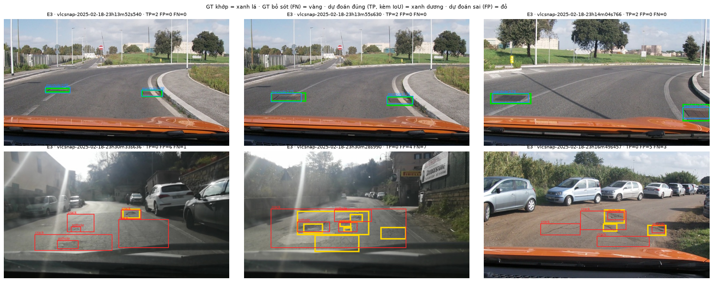
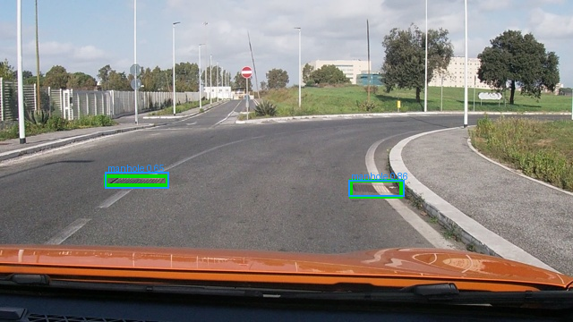
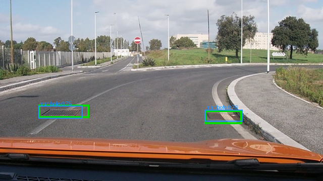
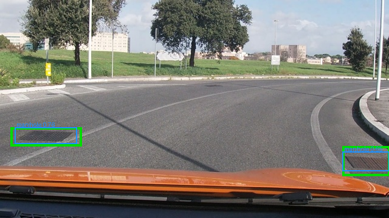
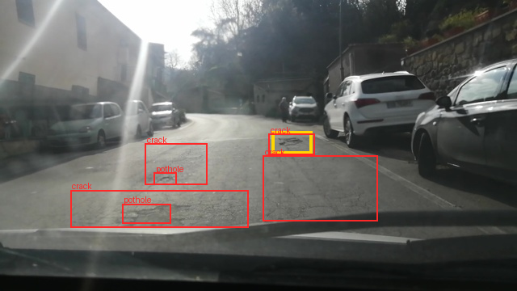
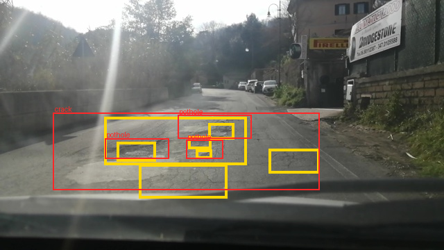
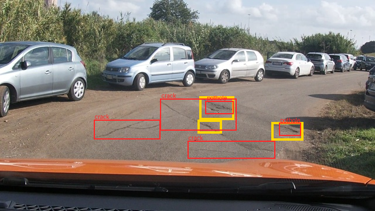

Họ tên: Đặng Hữu Tâm — 2A202602940
`dataset_version`: d10-21e4070301

> Phần cứng: mọi thí nghiệm chạy trên **1× RTX 5090 32 GB** (Vast.ai) thay vì Colab T4, cùng cấu hình QLoRA 4-bit NF4,
> fp16 AMP, batch 2 × accum 4, 300 bước. VRAM là `torch.cuda.max_memory_allocated` (không phụ thuộc dung lượng card);
> thời gian trên 5090 ngắn hơn T4 nhiều. Mã: `day10/`, notebook có output: `lab_day10.ipynb`, log từng run: `report/runs/`.

## Bảng tổng hợp (số của bạn, lấy từ `report/evidence/*.json`)

| Mã | Setup | Tham số huấn luyện | VRAM đỉnh (GB) | Phút | F1 | CI95 | FP/ảnh | F1 pothole | F1 crack | F1 manhole |
|---|---|---|---|---|---|---|---|---|---|---|
| E0 | zero-shot | 0 | – (suy luận 3.93) | – | 0.086 | 0.061–0.113 | 0.91 | 0.107 | 0.032 | 0.182 |
| E1 | LoRA LLM | 33,030,144 | 6.87 | 5.8 | 0.256 | 0.221–0.295 | 1.30 | 0.144 | 0.185 | 0.534 |
| E2 | + projector | 142,135,296 | 8.69 | 5.9 | 0.351 | 0.312–0.393 | 1.13 | 0.191 | 0.287 | 0.622 |
| E3 | + LoRA ViT | 148,426,752 | 8.88 | 7.3 | **0.436** | 0.394–0.480 | 0.93 | 0.314 | 0.345 | 0.709 |
| E4 | data_size = 0.1 (E3, 142 ảnh) | 148,426,752 | 8.28 | 11.5* | 0.289 | 0.252–0.327 | 1.62 | 0.220 | 0.211 | 0.547 |
| E4 | data_size = 1.0 (= E3) | 148,426,752 | 8.88 | 7.3 | 0.436 | 0.394–0.480 | 0.93 | 0.314 | 0.345 | 0.709 |
| E5 | GRPO từ E3 (60 bước) | 39,321,600 | 6.12 | 7.1 | 0.449 | 0.407–0.494 | 0.76 | 0.349 | 0.354 | 0.706 |

`parse_valid_rate`: E0 0.839 · E1 0.984 · E2/E3/E5 1.000 · E4(0.1) 0.997. `missing_predictions` = 0 ở mọi file.
\* E4(0.1) chạy **song song** với E5 trên cùng GPU nên 11.5 phút bị kéo dài do tranh chấp GPU, không so được với E1–E3
(E1–E3 chạy tuần tự, một mình trên GPU).

## 10 câu hỏi (trả lời bằng **số của bạn**, không chép lại tài liệu)

### Câu 1 — Kiến trúc: ViT, projector và LLM của Qwen3-VL-4B có bao nhiêu tham số mỗi khối, và E1/E2/E3 mỗi cái cập nhật khối nào?
Đếm trên model dựng từ config thật ở thiết bị `meta` (`architecture_breakdown()`, notebook mục 5):

| Khối | Tham số | Ghi chú |
|---|---|---|
| ViT (patch embed + pos embed + 24 block) | 306,242,560 | patch 16, gộp 2×2 |
| `visual.merger` | 27,271,680 | LayerNorm + 2 Linear (4096→4096→2560) |
| `visual.deepstack_merger_list` (3 merger) | 81,833,472 | lấy đặc trưng ViT ở lớp 5, 11, 17, cộng vào 3 lớp đầu của LLM |
| LLM `language_model` (36 lớp + embedding) | 4,022,468,096 | `lm_head` buộc chung trọng số với embedding (`tie_word_embeddings=True`) |
| **Tổng** | **4,437,815,808** | ViT + projector = 415,347,712 |

- **E1:** LoRA r=16 trên 252 Linear của LLM (36 lớp × q,k,v,o,gate,up,down) → 33,030,144 tham số; ViT, projector đóng băng.
- **E2:** E1 + mở toàn bộ projector (merger + deepstack = 109,105,152 tham số, fp32) → 142,135,296.
- **E3:** E2 + LoRA trên 96 Linear của ViT (24 block × attn.qkv, attn.proj, mlp.linear_fc1, mlp.linear_fc2) → 348 module,
  148,426,752 tham số. Số module được `assert` trong `apply_setup` và in ra trong log (`lora_modules: 252/252/348`).
- **E5:** chỉ cập nhật LoRA của E3 (39,321,600 = 33,030,144 LLM + 6,291,456 ViT); projector nạp từ E3 và đóng băng.

LLM chạy ở NF4 4-bit (log: `LLM: 252 Linear4bit`), ViT + projector + `lm_head` ở fp16 (`ViT+projector: 104 nn.Linear torch.float16`).

### Câu 2 — E0: `parse_valid_rate` bằng bao nhiêu, và hai lỗi phổ biến nhất của model gốc là gì (kèm một ví dụ output thô)?
`parse_valid_rate` = **0.839**: 50/311 output (16.1%) hỏng. Model gốc **không** bọc ```` ```json ```` và không thêm
câu chữ (0/311), toạ độ đúng thang 0–1000 (không box nào > 1000, trung vị toạ độ lớn nhất 710) — prompt đủ rõ về định
dạng. Hai lỗi chính:

1. **Lặp vô hạn → JSON bị cắt ở 256 token** (46/50 output hỏng không có `]` đóng). Model "lát gạch" cùng một box dịch đều từng bước:
   `[{"label": "crack", "bbox_2d": [500, 350, 520, 360]}, {"label": "crack", "bbox_2d": [520, 350, 540, 360]}, {"label": "crack", "bbox_2d": [540, 350, 560, 360]}, … [600` (ảnh `vlcsnap-2025-02-18-23h07m53s515`).
   4/50 còn lại là lỗi cú pháp đóng mảng bằng `)`: `{"label": "crack", "bbox_2d": [287, 478, 357, 500)}]`.
2. **Box sai vị trí / quá to và sai lớp — nhất là "crack".** Model vẽ một dải rộng cả khung hình thay cho các vết nứt:
   `[{"label": "crack", "bbox_2d": [0, 370, 1000, 700]}]` (val `…18h30m25s530`). Trong 321 box dự đoán có 203 box
   crack nhưng precision crack chỉ 0.039 (F1 crack 0.032); toàn bộ: P = 0.121, R = 0.067, chỉ đoán 321 box cho 583 GT.

Sau SFT, lỗi 1 gần như biến mất (E1 0.984, E2/E3 1.000) vì nhãn huấn luyện luôn kết thúc bằng `<|im_end|>`.

### Câu 3 — Thang 0–1000: nếu chấm output theo pixel (hoặc ngược lại) thì F1 ra sao và vì sao? Bạn đã kiểm chứng điều này thế nào?
**F1 sụp về 0 dù JSON hợp lệ 100%.** Mình kiểm chứng bằng chính trọng tài `scripts.score.evaluate`
(`day10/coord_check.py`, notebook mục 2 và 8), trên 311 ảnh test (583 box):

| Dự đoán | Chấm bằng | parse_valid | F1 | TP / FP / FN |
|---|---|---|---|---|
| nhãn đúng (oracle), thang 0–1000 | `--coord norm1000` | 1.000 | **1.000** | 583 / 0 / 0 |
| nhãn đúng, thang pixel | `--coord pixel` | 1.000 | **1.000** | 583 / 0 / 0 |
| nhãn đúng, thang pixel | `--coord norm1000` (sai thang) | 1.000 | **0.000** | 0 / 583 / 583 |
| nhãn đúng, thang 0–1000 | `--coord pixel` (sai thang) | 1.000 | **0.000** | 0 / 583 / 583 |
| dự đoán thật của E3 | `--coord norm1000` | 1.000 | 0.436 | 243 / 289 / 340 |
| dự đoán thật của E3 | `--coord pixel` (sai thang) | 1.000 | **0.000** | 0 / 532 / 583 |

**Vì sao:** `--coord pixel` đổi `x·1000/640`, `y·1000/360`. Nếu output thực ra đã ở 0–1000 thì box bị kéo giãn ×1.56
theo x và ×2.78 theo y, lệch hẳn khỏi GT (phần lớn còn trượt ra ngoài khung). Box ở đây rất nhỏ (trung vị 0.4–2% diện
tích ảnh), nên chỉ lệch vài phần trăm là IoU < 0.5 — không còn cặp nào khớp. Chiều ngược lại (pixel chấm như 0–1000)
co box về góc trên-trái, cũng IoU = 0. Trọng tài vẫn parse được nên lỗi này **im lặng**: chỉ thấy F1 ≈ 0 mà
`parse_valid_rate` = 1.

**Vì sao Qwen3-VL dùng 0–1000:** ảnh bị processor resize (ở đây 640×360 → 640×352, bội số 32), nên "pixel" của model
khác pixel của file gốc; thang tương đối 0–1000 độc lập với độ phân giải và tỉ lệ resize, là quy ước grounding model đã
học khi pretrain (nên E0 tự ra đúng thang), và giới hạn tập số nguyên model phải sinh trong [0, 1000].
Unit test `day10/tests/test_labels.py::test_scale_mismatch_kills_f1` khoá lại hành vi này.

### Câu 4 — Mask loss: vì sao chỉ tính loss trên phần trả lời? Điều gì xảy ra nếu tính trên cả prompt và token ảnh?
Ví dụ train đầu tiên (notebook mục 4): chuỗi **562 token**, trong đó 220 token ảnh (`image_grid_thw=[1,22,40]` →
22·40/4 = 220) + ~92 token template/prompt = **312 token gán −100**, chỉ **250 token (44.5%)** của JSON 9 box +
`<|im_end|>\n` được học. Với ảnh 2 box (kiểm thử trên CPU) tỉ lệ còn thấp hơn: học 59/371 token (16%). Kiểm chứng: giải
mã riêng các token `labels != -100` ra **đúng** chuỗi đáp án, khớp từng ký tự với `objects_to_answer(...)`, kết thúc
bằng `<|im_end|>\n`; `encode_example` còn kiểm tra prompt là tiền tố của chuỗi đầy đủ.

Lý do và hệ quả nếu không mask:
- **Prompt giống hệt nhau ở mọi mẫu** → model chỉ học thuộc câu lệnh; loss trên phần đó tụt về ~0 rất nhanh và kéo
  loss trung bình xuống, che mất tín hiệu của phần toạ độ (loss là trung bình theo token: phần trả lời chỉ còn 16–45%
  trọng số).
- **Token ảnh** trong `input_ids` đều là cùng một placeholder `<|image_pad|>` (220 lần): "dự đoán" chúng là bài toán
  tầm thường, không dạy gì về thị giác nhưng chiếm phần lớn chuỗi → gradient bị pha loãng. Mặt khác đặc trưng ảnh đi
  vào qua `pixel_values`, không phải qua id này.
- Model có thể học sinh lại prompt/placeholder lúc suy luận; và loss giữa các setup không còn so sánh được.
Thực tế đo được: chỉ mask đúng cũng đủ đưa `parse_valid_rate` từ 0.839 (E0) lên 0.984–1.000 sau 300 bước.

### Câu 5 — Vì sao không thể huấn luyện đầy đủ projector nếu ViT bị lượng tử hoá 4-bit, và bạn đã xử lý thế nào? Vì sao projector phải ở float32?
**Không huấn luyện được** vì khi bị lượng tử hoá, `Linear` thành `bnb.nn.Linear4bit` với trọng số `Params4bit` là byte
`uint8` đóng gói (2 giá trị NF4/byte) + hằng số scale; mỗi lần forward mới giải nén ra fp16. Tensor nguyên không có
gradient và không có phép "cộng một bước Adam" vào giá trị NF4 — chỉ có thể gắn LoRA lên trên chứ không cập nhật đầy đủ.

**Mình gặp đúng lỗi này** khi chạy thử trên GPU: với `llm_int8_skip_modules=["visual", "lm_head"]` như GUIDE, E2 báo
`projector_params = 54,579,200` — đúng **một nửa** 109,105,152 (vì `numel()` của tensor đóng gói 4-bit chỉ còn n/2) —
rồi `ValueError: Attempting to unscale FP16 gradients`. Nguyên nhân: transformers 5.19 so khớp module bỏ qua bằng
`re.match(key, full_name)` (neo ở **đầu** tên) hoặc `endswith`, mà tên thật là `model.visual.blocks…`, nên `"visual"`
không khớp và cả ViT + projector bị 4-bit **âm thầm**. **Xử lý:** `llm_int8_skip_modules=["model.visual", "lm_head"]` và
hàm `assert_vit_not_quantized()` chạy sau mỗi lần nạp model (log: `LLM: 252 Linear4bit · ViT+projector: 104 nn.Linear
torch.float16`). Sau khi sửa, E2/E3 mở đúng 109,105,152 tham số projector.

**Vì sao fp32:** (1) Adam cập nhật `lr·m/√v` ~ 2e-4 × O(1) trên trọng số cỡ 1e-2…1; fp16 chỉ có ~3 chữ số thập phân
(khoảng cách giữa hai số fp16 gần 1 là ~1e-3), nên nhiều bước cập nhật nhỏ bị làm tròn mất — cần bản "master weight"
fp32. (2) `GradScaler.unscale_` từ chối gradient fp16 (chính là lỗi ở trên), nên mọi tham số huấn luyện phải fp32;
`apply_setup` kiểm tra điều này. Tính toán vẫn chạy fp16 trong `autocast`. Khi suy luận, projector được chép về tham số
fp16 của model gốc (`load_projector` in checksum trước/sau để chắc đã nạp, vd `1342.2666 → 1342.2638`).

### Câu 6 — Split theo phiên quay: vì sao chia ngẫu nhiên sẽ cho F1 cao giả? Số ảnh và số box từng lớp ở mỗi split là bao nhiêu?

| Split | Ảnh | Phiên quay | pothole | crack | manhole |
|---|---|---|---|---|---|
| train | 1,422 | 13 | 1,074 | 1,750 | 691 |
| val | 276 | 2 | 66 | 470 | 103 |
| test | 311 | 3 | 121 | 299 | 163 |

`day10/check_data.py` xác nhận không session nào nằm ở hai split và số liệu khớp đề (`dataset_version d10-21e4070301`).

Ảnh là frame cắt từ video dashcam: các frame liền nhau trong một phiên (tên file cách nhau 1–3 giây, vd
`…23h13m52s540` và `…23h13m55s630` trong ảnh minh hoạ bên dưới) có **cùng đoạn đường, cùng ổ gà/nắp cống, cùng ánh
sáng**, chỉ dịch vài pixel. Chia ngẫu nhiên thì gần như mọi ảnh test đều có "anh em sinh đôi" trong train → model chỉ
cần nhớ vị trí box của frame bên cạnh là đạt IoU ≥ 0.5, F1 test đo **khả năng nhớ** chứ không phải khả năng tổng quát
sang con đường mới; khi triển khai thật F1 sẽ tụt mạnh. Chia theo phiên làm test là 3 chuyến quay model chưa từng thấy.
Cái giá: phân bố lớp lệch (val chỉ 66 pothole, test crack chiếm 51% box) và số phiên rất ít — xem Câu 8. (Mình không
chạy thêm split ngẫu nhiên để đo mức "F1 giả" cụ thể.)

### Câu 7 — So sánh E1/E2/E3: mở projector và LoRA trên ViT có đáng không (F1, CI95, VRAM, thời gian)?

| | Tham số | F1 [CI95] | ΔF1 | VRAM | Phút | P / R | FP/ảnh |
|---|---|---|---|---|---|---|---|
| E1 | 33.0M | 0.256 [0.221–0.295] | — | 6.87 | 5.8 | 0.264 / 0.249 | 1.30 |
| E2 | 142.1M | 0.351 [0.312–0.393] | +0.095 | 8.69 (+1.82) | 5.9 | 0.362 / 0.341 | 1.13 |
| E3 | 148.4M | 0.436 [0.394–0.480] | +0.085 | 8.88 (+0.19) | 7.3 | 0.457 / 0.417 | 0.93 |

**Có, cả hai bước đều đáng.**
- **Mở projector (E1→E2):** +0.095 F1, CI95 **không chồng** (0.295 < 0.312) → cải thiện thật. Gần như không tốn thời
  gian (+0.1 phút) — chi phí chủ yếu là VRAM +1.8 GB cho 109M tham số fp32 cùng gradient và 2 moment Adam
  (109M × 16 byte ≈ 1.7 GB, khớp số đo). Đáng nhất về "F1 trên mỗi GB".
- **LoRA ViT (E2→E3):** +0.085 F1 với chỉ +6.3M tham số; CI95 **vừa chạm nhau** (0.393 vs 0.394) → bằng chứng mạnh nhưng
  sát ngưỡng. Tốn +1.4 phút (25%) vì gradient phải lan ngược qua 24 block ViT, VRAM chỉ +0.19 GB nhờ gradient checkpointing.
  Cải thiện rõ nhất ở lớp nhỏ: pothole 0.191→0.314, manhole 0.622→0.709 — điều chỉnh đặc trưng thị giác giúp vật nhỏ.
- Setup dùng nhiều VRAM nhất là E3 (8.88 GB): vừa có tham số fp32 của projector + trạng thái Adam, vừa lưu activation
  để lan gradient qua ViT. E1 thấp nhất vì gradient dừng ở LLM.
Ở ngân sách 300 bước, xu hướng là **càng mở nhiều khối thị giác càng tốt**: bài toán vật rất nhỏ cần thay đổi cách "nhìn",
không chỉ cách "nói".

### Câu 8 — Tập test có 311 ảnh: khoảng tin cậy rộng thế nào, và điều đó giới hạn kết luận so sánh các setup ra sao?
CI95 bootstrap (lấy mẫu lại **ảnh**, 1000 lần) rộng **0.052–0.087** điểm F1: E0 0.052, E1 0.074, E2 0.081,
E3 0.086, E4(0.1) 0.075, E5 0.087 — tức khoảng ±0.04 quanh giá trị trung tâm. Hệ quả:
- **Kết luận được:** E0 < E1 < E2 (khoảng tách rời), E4(10%) < E4(100%) (0.327 < 0.394), và E1 vượt E0 ~0.17.
- **Sát ngưỡng:** E2 vs E3 (0.393 vs 0.394) — chỉ nên nói "E3 có vẻ tốt hơn".
- **Không kết luận được:** E5 vs E3 (0.449 vs 0.436, chồng gần hết) — +0.013 nằm trong nhiễu.
Thêm ba lý do khiến CI này **còn lạc quan**:
1. Test chỉ có **3 phiên quay**; ảnh trong một phiên tương quan mạnh (frame liền kề), nên 311 ảnh không phải 311 mẫu độc
   lập. Bootstrap theo ảnh đánh giá thấp phương sai; bootstrap theo phiên (chỉ 3 đơn vị) sẽ cho khoảng rộng hơn nhiều.
2. Mỗi setup chỉ chạy **1 seed**; biến thiên do khởi tạo LoRA/thứ tự dữ liệu không nằm trong CI.
3. So hai setup bằng "hai CI có chồng nhau không" là phép thử bảo thủ nhưng bỏ qua tính ghép cặp (cùng 311 ảnh);
   bootstrap ghép cặp hiệu số F1 sẽ chặt hơn — `score.py` không làm, mình nêu như một giới hạn.
Ngoài ra F1 từng lớp có CI còn rộng hơn (pothole chỉ 121 box test), nên các so sánh theo lớp chỉ mang tính gợi ý.

### Câu 9 — Phân tích lỗi theo lớp: lớp nào kém nhất và vì sao (kích thước box, số mẫu, ngữ nghĩa)? Kèm ảnh minh hoạ.
Với E3 (setup tốt nhất): **pothole F1 0.314** và **crack 0.345** kém, **manhole 0.709** tốt.
Số liệu (`python -m day10.analyze classes --pred work/e3.jsonl`):

| Lớp | Box train | Diện tích trung vị (test) | Recall theo kích thước box (test) |
|---|---|---|---|
| pothole | 1,074 | 0.42% | <0.3%: 8/40 = 0.20 · 0.3–1%: 18/54 = 0.33 · ≥1%: 12/27 = 0.44 |
| crack | 1,750 | 1.98% | <0.3%: 0/7 · 0.3–1%: 6/61 = 0.10 · ≥1%: 93/231 = 0.40 |
| manhole | 691 | 0.67% | <0.3%: 9/21 = 0.43 · 0.3–1%: 60/95 = 0.63 · ≥1%: 37/47 = 0.79 |

- **Pothole — kích thước:** box nhỏ nhất (trung vị 0.42% khung hình, 1/3 số box test (40/121) có diện tích < 0.3%); recall tăng đều theo kích
  thước (0.20 → 0.33 → 0.44). Với box vài chục pixel, lệch 1–2 token toạ độ đã làm IoU < 0.5 (43 FP "lệch vị trí").
  Thêm nhầm lớp pothole↔manhole (17 + 3 FP): cả hai là vùng tối, tròn trên mặt đường.
- **Crack — ngữ nghĩa/nhãn:** nhiều mẫu nhất (1,750) mà vẫn kém → không phải do thiếu dữ liệu. Vết nứt dài, mảnh, không có
  biên rõ; cùng một mạng nứt có thể được gán một box dài hay nhiều box ngắn. FP lớn nhất toàn bộ là
  **crack lệch vị trí (0 < IoU < 0.5): 121** — model tìm đúng chỗ nứt nhưng cắt box khác người gán nhãn. Box nứt nhỏ
  (< 1%) gần như không bắt được (6/68).
- **Manhole — tốt nhất** dù ít mẫu nhất (691): hình dạng đều, viền rõ, màu kim loại tương phản; recall 0.79 với box ≥ 1%.

Kết luận: độ khó do **kích thước** (pothole) và **sự mơ hồ của nhãn** (crack) chi phối, không phải số mẫu.

Ảnh minh hoạ E3 trên test — GT khớp: xanh lá · GT bỏ sót (FN): vàng · dự đoán đúng (TP, kèm IoU): xanh dương ·
dự đoán sai (FP): đỏ.



| | |
|---|---|
|  **Đúng 1** · `…23h13m52s540` · TP=2 FP=0 FN=0: hai box trên mặt đường khô, rõ, đều khớp. |  **Đúng 2** · `…23h13m55s630` · TP=2 FP=0 FN=0: frame cách 3 giây cùng phiên — minh hoạ vì sao không được chia ngẫu nhiên. |
|  **Đúng 3** · `…23h14m04s766` · TP=2 FP=0 FN=0: cả box sát mép phải khung hình. |  **Sai 4** · `…23h30m33s636` · TP=0 FP=6 FN=1: ngược sáng, mặt đường loang lổ → bịa nhiều crack/pothole. |
|  **Sai 5** · `…23h30m28s990` · TP=0 FP=4 FN=7: mặt đường vá chằng chịt; model vẽ một box crack lớn thay vì nhiều ổ gà nhỏ → toàn bộ IoU < 0.5. |  **Sai 6** · `…23h16m49s457` · TP=0 FP=5 FN=3: đường đất, crack khó phân biệt nền; box lệch vị trí. |

Ảnh mẫu nhãn gốc (chặng 1): `report/figures/data_samples.png`.

### Câu 10 — E4: bạn đổi biến nào, kết quả thế nào, và kết luận có đáng tin không?
Biến: **`data_size`** trên setup tốt nhất **E3**, chỉ đổi số ảnh train; giữ nguyên rank 16, lr 2e-4, batch 2×4,
**300 bước**, seed 42. 10% = 142 ảnh lấy ngẫu nhiên (seed 42); 100% chính là E3 (chấm lại thành `e4_data_1.0.json`).

| data_size | Ảnh train | Epoch (300 bước × 8) | Loss 10 bước cuối | F1 [CI95] | P / R | FP/ảnh |
|---|---|---|---|---|---|---|
| 0.1 | 142 | 16.9 | **0.0067** | 0.289 [0.252–0.327] | 0.267 / 0.316 | 1.62 |
| 1.0 | 1,422 | 1.69 | 0.491 | 0.436 [0.394–0.480] | 0.457 / 0.417 | 0.93 |

- F1 giảm 0.147 khi chỉ còn 10% dữ liệu; hai CI95 **tách rời** (0.327 < 0.394) → kết luận "nhiều dữ liệu hơn tốt hơn"
  đáng tin trong phạm vi test này, kể cả khi CI thật rộng hơn (Câu 8), vì khoảng cách lớn gấp ~2 lần nửa độ rộng CI.
- Nhưng **không tách được hai nguyên nhân**: giữ 300 bước (để chỉ đổi một biến) khiến 142 ảnh bị lặp ~17 epoch, loss
  train về 0.0067 — model **học thuộc** tập nhỏ (FP/ảnh tăng 0.93 → 1.62, precision tụt mạnh hơn recall). Vậy E4 đo
  "ít dữ liệu + overfit" chứ không riêng "ít dữ liệu".
- Đáng chú ý: chỉ 142 ảnh vẫn cho F1 0.289 > E1 dùng đủ 1,422 ảnh (0.256) — mở đủ khối thị giác quan trọng hơn gấp 10
  lần dữ liệu ở ngân sách này (nhưng hai thí nghiệm này khác nhau nhiều biến, chỉ là quan sát).
- Giới hạn: 1 seed, 1 lần lấy mẫu 142 ảnh; thời gian 11.5 phút không so được vì chạy song song với E5 trên cùng GPU.

## E5 (tuỳ chọn) — GRPO với reward IoU
- **Reward + test:** `day10/reward.py` (0 nếu JSON hỏng; 1 nếu cả hai rỗng; còn lại 0.2 + 0.8·ΣIoU/max(n_gt, n_pred, 1),
  ghép tham lam cùng lớp, IoU ≥ 0.5). 13 test trong `day10/tests/test_reward.py` (hoàn hảo 1.0, JSON hỏng 0.0, sai lớp
  0.2, thừa box 0.6, cả hai rỗng 1.0, box khổng lồ 0.2, ghép 1-1, IoU dưới ngưỡng, chữ ký hàm của trl…) — đều pass.
- **Chạy:** `trl==1.9.2` GRPOTrainer, khởi tạo từ adapter E3 (projector E3 đóng băng), 60 bước, lr 5e-6, β = 0,
  4 lần sinh/ảnh, `max_completion_length` 128, temperature 1.0, 480 ảnh train; fp16 (T4/5090 không dùng mặc định bf16 của
  trl), khôi phục adapter fp32 sau khi trl ép bf16. 7.1 phút, VRAM 6.12 GB. Log: `report/e5_grpo_log.json`.
- **Diễn biến (trung bình 10 bước đầu → 10 bước cuối):** reward 0.405 → 0.453; độ dài completion 53 → 48 token; tỉ lệ bị cắt
  ở 128 token 3.7% → 1.3%; `frac_reward_zero_std` (nhóm 4 lần sinh cùng reward → advantage = 0, không có gradient)
  0.10 → 0.15.
- **Reward hacking?** Không thấy dạng thô: tỉ lệ output `[]` = 0% (E3 cũng 0%), không box nào > 25% ảnh, diện tích box
  trung bình 2.17% → 2.31%. Lưu ý dataset **không có ảnh rỗng** nên chiến thuật `[]` chỉ được 0.2, không bao giờ 1.0.
  Có một dịch chuyển nhẹ theo hướng "thận trọng": số box/ảnh 1.71 → 1.52 (GT 1.87), FP/ảnh 0.93 → 0.76, precision
  0.457 → 0.502 nhưng recall 0.417 → 0.407 — mẫu số max(n_gt, n_pred) phạt box thừa, nên bớt box là cách "an toàn" tăng
  reward; nếu chạy lâu hơn có thể thành bỏ sót nhiều.
- **So với SFT:** F1 0.436 [0.394–0.480] → **0.449 [0.407–0.494]**, +0.013 nhưng CI95 chồng gần hoàn toàn → **không có
  bằng chứng** GRPO 60 bước cải thiện F1; thay đổi thấy được chỉ là đánh đổi precision/recall ở trên.

## Nhìn lại
- **Lỗi nguy hiểm nhất không bị công cụ chấm bắt:** cấu hình `llm_int8_skip_modules=["visual", …]` của đề âm thầm lượng tử
  hoá cả ViT ở transformers 5.19. Nếu không chạy thử và đếm tham số projector, E0–E3 vẫn ra số "hợp lệ" nhưng sai bản chất.
  Bài học: luôn assert kiểu lớp/số tham số sau khi nạp model, đừng tin cấu hình chạy không báo lỗi.
- Collate mẫu của đề thiếu `mm_token_type_ids` (bắt buộc cho M-RoPE ở transformers 5.19); list `target_modules` hậu tố
  cho E3 khớp nhầm 8 Linear của projector (332 thay vì 348 module). Ghi chi tiết ở `BAO_CAO_LOI_VA_LUU_Y.md`.
- **Lỗi của chính mình:** (1) ô gỡ lỗi `E1val` chấm 40 dự đoán trên toàn bộ 276 ảnh val nên ra `valid=0.141` vô nghĩa —
  trọng tài tính ảnh thiếu dự đoán là "không hợp lệ"; phải nhìn `missing_predictions`. (2) Khi tăng tốc bằng cách chạy song
  song, hai tiến trình cùng ghi `work/e2.jsonl` trong vài giây → 20 dòng trùng `image_id` (trọng tài sẽ từ chối). Mình
  đã khử trùng (giữ dòng đầu; suy luận greedy nên các dòng trùng giống hệt nhau) rồi mới chấm. (3) Ô cuối notebook dùng
  `$d` trong lệnh shell, IPython thay bằng biến Python `d` nên lệnh chép `run.json` lỗi; mình chép tay vào `report/runs/`.
- **Chưa hiểu hết / chưa làm:** mức F1 "giả" khi chia ngẫu nhiên (chưa đo); CI theo phiên quay và nhiều seed để biết
  E2 vs E3 có thật sự khác nhau; vì sao ở lần chạy thử E3 bước đầu cho `gnorm = nan` (GradScaler bỏ qua bước tràn số fp16 —
  gradient qua ViT lớn hơn) trong khi E1/E2 thì không.
